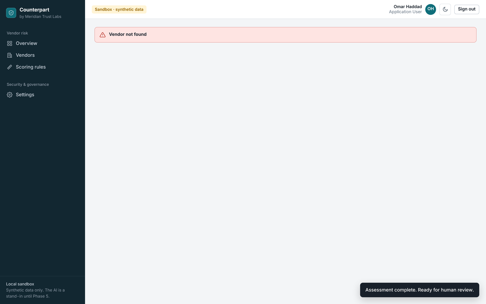

# Milestone 2: Working App Controls

| | |
|---|---|
| **System** | Counterpart, Meridian Trust Labs (fictional) |
| **Scope** | The local working app: `app/ai_worker/`, `app/decision/`, `app/common/`, `app/web/` |
| **Covers brief phases** | 4 (minimum application), 5 (AI integration, with a pretend model), 7 (human review) |
| **Version** | 1.0, draft for review |
| **Builds on** | [Intake scanner controls](intake-controls.md), [scoring methodology](../risk-management/scoring-methodology.md) |

## 1. What a user can do now

The app runs on one computer with fictional people and synthetic vendors. Every rule below is enforced by the server, exactly as it will be in AWS.

| Who (fictional) | Role | Can | Can't |
|---|---|---|---|
| Priya Shah, Omar Haddad | Application User | Add vendors, upload their documents, run an assessment | See each other's vendors; record any decision |
| Dana Whitfield, Marcus Lee | Vendor Risk Reviewer | See all vendors, run assessments, record decisions | Upload documents; decide on a vendor they requested |
| Sam Ortiz | Administrator | Read the audit log, change settings (red team mode) | See vendor data; record decisions |
| Jasmine Alexander | ISSO (read-only) | See all vendors and the audit log | Change anything |


## 2. How one assessment flows

```
Upload ─► Intake scanner ─► Prompt (fenced) ─► Model ─► Schema check ─► Quote check ─► Rules engine ─► Reviewer decides
           rejects or          one vendor        pretend    unknown field     every quote      score from      separate,
           strips hidden       per request       for now    = reject all      must exist       evidence        append-only record
```

The model reads, the code scores, and a person decides. Nothing on the left of "Reviewer decides" can set a vendor's status.

## 3. Controls

Each row: threat → control → where it's implemented → the test that proves it → evidence.

### 3.1 The AI can't approve anything (AR-06 Excessive agency → SR-12, HR-01, HR-02; OWASP LLM06)

| Control | Implementation | Test |
|---|---|---|
| The assessment record has no decision field | `app/ai_worker/pipeline.py` | `test_assessment_record_has_no_decision` |
| A model answer with any unexpected field, such as `decision` or `risk_score`, is rejected entirely | `app/ai_worker/schema.py` | `test_model_that_tries_to_approve_is_rejected_entirely`, `test_structural_problems_reject_the_whole_answer` |
| The AI code never imports the decision service | Module boundary | `test_ai_worker_never_imports_the_decision_service` |
| Decisions are separate records, appended and never changed | `app/common/store.py`, `app/decision/service.py` | `test_a_final_decision_is_never_replaced` |
| A rejected assessment can't be decided on | `app/decision/service.py` | `test_rejected_ai_output_cannot_be_decided` |

**Demo:** an Administrator turns on red team mode "model falls for the injection". The next assessment is rejected with *Unexpected field in the answer: decision, risk_score*. No score is produced and nothing changes.


### 3.2 The AI can't invent evidence (AR-07 Misinformation → SR-13; OWASP LLM09)

| Control | Implementation | Test |
|---|---|---|
| Every quote must appear, word for word, at the cited page or question in a document uploaded for this vendor | `schema._check_citation` | `test_quote_must_exist_at_the_cited_location` |
| A finding left with no real quote counts as missing evidence | `CheckedFinding.for_rules_engine` + rules engine | `test_finding_with_only_unverified_quotes_counts_as_uncited` |
| Invented evidence can only make a vendor look worse, never better | Combination of the two above | `test_invented_evidence_never_lowers_a_score` |
| **"Verified" needs an independent audit report** (added in Phase 5). A person labels each document's type at upload; a verified claim with no found quote from an audit report is scored as unverified. Closes the gap where a real quote from a vendor's own letter could pass the quote check | `pipeline.require_independent_evidence` | `test_vendor_written_documents_cannot_verify`, `test_unlabelled_documents_count_as_vendor_claims` |

**Demo:** red team mode "model invents evidence" marks every control verified with made-up quotes. All of them are caught, and the score goes *up* to 100 Critical.

### 3.3 Documents are data, not instructions (AR-01, AR-02 → SR-08, SR-09, SR-10; OWASP LLM01, LLM07)

| Control | Implementation | Test |
|---|---|---|
| Hidden text never reaches the prompt | Intake scanner, then prompt builder | `test_hidden_text_never_reaches_the_prompt` |
| Document text sits inside a fence with a random name per request; a document can't close it | `app/ai_worker/prompt.py` | `test_fence_name_is_random_and_cannot_be_closed_by_a_document` |
| Instructions live only in the system prompt; document text never does | Same | `test_document_text_is_never_in_the_system_prompt` |
| One vendor's documents per request (SR-09) | `build_prompt` takes one vendor | Pipeline tests use one vendor each |
| No secrets in the system prompt (SR-10) | Same | `test_system_prompt_holds_no_secrets` |

### 3.4 Access control (TR-01, TR-02 → SR-01, SR-02, SR-03; NIST 800-53 AC-3, AC-5, AC-6, IA-2)

| Control | Implementation | Test |
|---|---|---|
| Default deny: each role lists what it may do; anything else is refused | `app/common/auth.PERMISSIONS` | `test_roles_are_enforced_on_the_server` |
| Object-level checks: an Application User sees only vendors they requested. Anything else returns "not found" | `auth.can_view_vendor`, `server._visible_vendor` | `test_users_cannot_see_each_others_vendors` |
| Only a Vendor Risk Reviewer can decide | `decision.service` and the API | `test_only_reviewers_can_decide_and_refusals_are_logged` |
| Separation of duties: no deciding on a vendor you requested or uploaded for | `decision.service` | `test_separation_of_duties` |
| Two-person rule: approving a Critical vendor needs a second, different reviewer | `decision.service` | `test_critical_approval_needs_a_second_different_reviewer` |
| Fresh sign-in: a decision needs a sign-in within 15 minutes | `Session.fresh` | `test_decision_needs_a_recent_sign_in` |
| Reviewer must write a rationale and confirm they examined the evidence (HR-07, guards against automation bias AR-10) | `decision.service` | `test_required_contents` |
| Overrides of the rating are flagged (HR-05) | `decision.service` | `test_overrides_are_flagged` |



### 3.5 Web application defences (OWASP Top 10 2021 A01, A03, A05)

| Control | Implementation | Test |
|---|---|---|
| Content Security Policy allows only the app's own scripts and styles; no inline code, no `eval` | `server.SECURITY_HEADERS` | `test_security_headers_on_every_response` |
| Every value from the server is shown as text, never inserted as HTML, so text in a vendor document can't run as code | `app/web/static/app.js`, function `h()` | Code review; the CSP above is the backstop |
| Cross-site request forgery: changes need a custom header plus a SameSite=Strict cookie | `server._call` | `test_changes_without_the_request_header_are_refused` |
| Session cookie is HttpOnly and SameSite=Strict; the token is random and held only in server memory | `server`, `auth.Sessions` | `test_session_cookie_is_httponly_and_samesite_strict` |
| Strict ID formats and an allowlist of static files block path tricks | `server` routes | `test_unknown_routes_and_bad_ids_are_not_found` |
| Errors never reveal internals | `server._dispatch` | Manual check |
| The server listens only on this computer | `make_server(host="127.0.0.1")` | Configuration |

### 3.6 Audit (TR-07 → SR-16; AU-2, AU-3, AU-9, AU-12)

| Control | Implementation | Test |
|---|---|---|
| Sign-ins, uploads, assessments, decisions, setting changes and every denial are logged with who, what, when and outcome | `app/common/audit.py`, called throughout | `test_only_reviewers_can_decide_and_refusals_are_logged` |
| Each event carries a hash of the previous one; editing history breaks the chain and the ISSO screen shows where | `AuditLog.verify` | `test_editing_an_old_event_breaks_the_chain` |
| The log refuses document text, quotes, excerpts and tokens | `FORBIDDEN_DETAIL_KEYS` | `test_audit_refuses_document_contents`, `test_audit_log_is_intact_and_holds_no_document_text` |


## 4. Proving the tests can fail

Four protections were deliberately broken before this was committed:

| Protection removed | Tests that failed |
|---|---|
| Rejecting unexpected fields in model output | 4 (including the "AI tries to approve" test) |
| Separation of duties | 1 |
| The two-person rule | 2 |
| Object-level vendor access checks | 2 |

All 95 tests passed again once the code was restored.

## 5. What changes in AWS (Milestone 3)

| Local | AWS |
|---|---|
| Choose a demo user | Amazon Cognito sign-in with MFA; `auth_time` claim for the fresh sign-in check |
| JSON files | DynamoDB tables; decisions table with no update or delete permission for any role |
| Files in a folder | S3 `documents` bucket, KMS-encrypted; quarantine bucket for uploads |
| Hash-chained log file | S3 audit bucket with Object Lock, plus CloudTrail and CloudWatch |
| Pretend model | Amazon Bedrock, pinned model version (Phase 5) |
| One Python process | API Gateway + one Lambda per component, each with its own IAM role; the AI worker role explicitly denied the decisions table |

## 6. Known limitations (candidates for the POA&M)

| # | Limitation | Planned response |
|---|---|---|
| M-1 | Local sign-in has no password or MFA | Cognito with MFA in Milestone 3 |
| M-2 | No per-user limit on assessments yet (part of SR-14) | Per-user and monthly caps with Bedrock in Phase 5 |
| M-3 | The pretend model only knows the three sample vendors | Real model in Phase 5. The validator and guardrails don't change. |
| M-4 | The local audit file can be deleted outright; the hash chain detects edits, not deletion of the whole file | S3 Object Lock in Milestone 3 |
| M-5 | Sessions are lost when the server restarts | Expected for a local sandbox; Cognito tokens in AWS |
| M-6 | A newer assessment puts the vendor back to "Awaiting human decision" even if an earlier one was decided | Intended: decisions apply to the evidence reviewed. To review in Phase 7 policy |

## 7. Run it yourself

```bash
python3 -m pip install -r requirements.txt
python3 scripts/run_app.py
```

Then open http://127.0.0.1:8000 and sign in as Priya. Upload the three files from `sample-data/nimbus-notes-ai/`. To start over: `python3 scripts/run_app.py --reset`.
